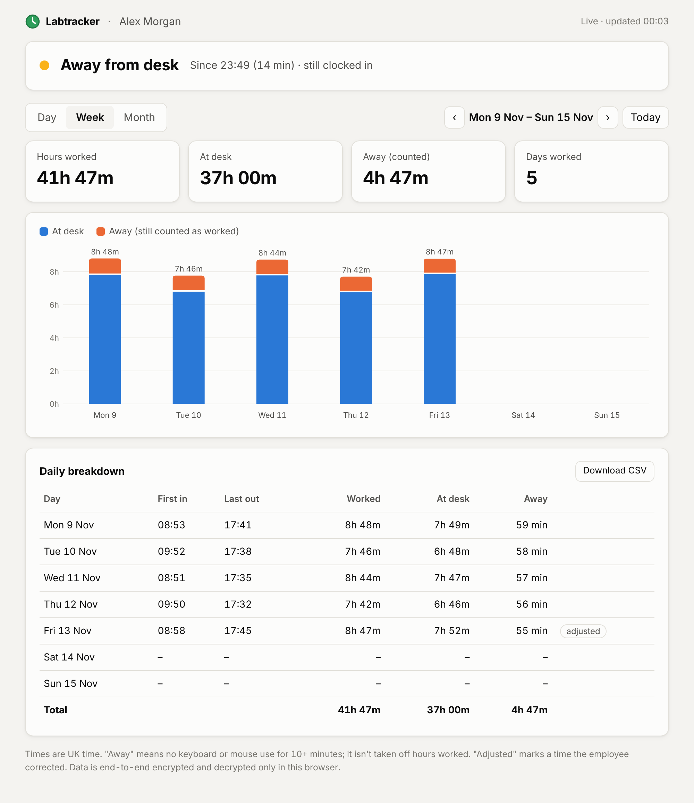
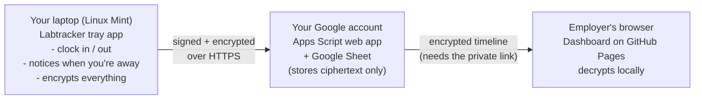
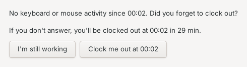
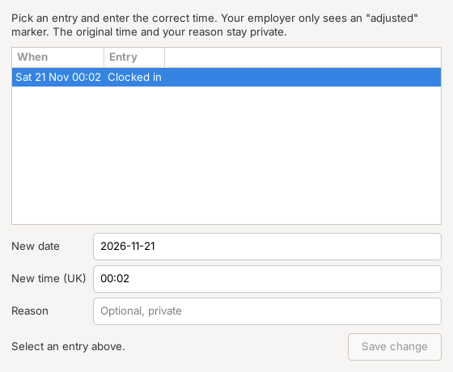
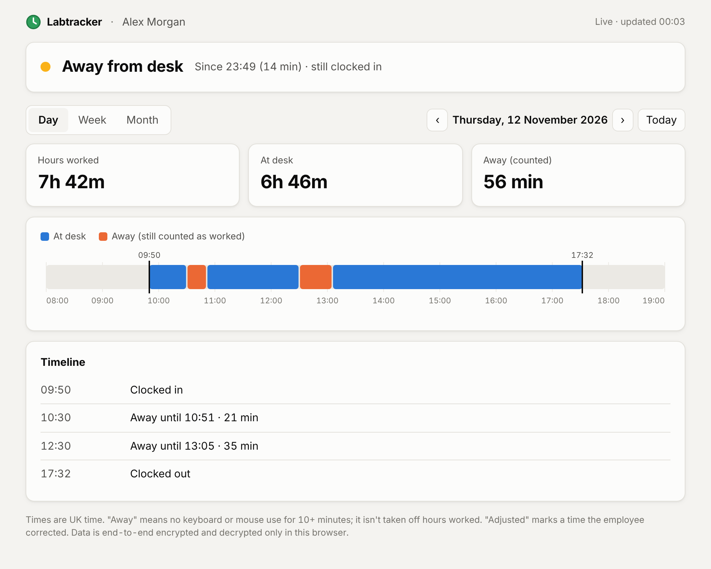

# Labtracker

**A free, private clock-in / clock-out tracker for people who work from home.**
You clock in and out from a small icon in your Linux Mint panel. Labtracker notices when you've
stepped away from the keyboard and asks if you forgot to clock out. Your employer sees a live,
read-only dashboard of your day, week and month.

- **Free to run.** It uses your own Google Sheet for storage and GitHub Pages for the dashboard. No servers, no subscriptions.
- **You own your records.** They live in *your* Google account.
- **End-to-end encrypted.** Everything is encrypted on your laptop before it is sent. Google only ever stores scrambled data. Your private notes can't be read by your employer.
- **Honest corrections.** You can fix a forgotten clock-out. Your employer sees a small "adjusted" marker, but not the original time or your reason.



---

## Contents
1. [How it works](#how-it-works)
2. [Setup (about 20 minutes, once)](#setup)
3. [Daily use](#daily-use)
4. [For employers: reading the dashboard](#for-employers)
5. [Security and privacy](#security-and-privacy)
6. [Commands](#commands)
7. [Updating and uninstalling](#updating-and-uninstalling)
8. [Troubleshooting](#troubleshooting)
9. [For developers](#for-developers)

---

## How it works



| Part | What it is | Where it runs |
|---|---|---|
| **Tray app** | A small Python app with a clock icon in your panel. It starts when you log in. | Your Linux Mint laptop |
| **Backend** | A short script attached to a Google Sheet. It receives your events and stores them. | Your Google account (free) |
| **Dashboard** | A web page that shows status, timelines and totals. | GitHub Pages (free) |

**The icon in your panel:** 🟢 clocked in · 🟠 away from the keyboard · ⚪ clocked out.

**What counts as "away":** 10 minutes without any keyboard or mouse use. Away time shows on the
timeline, but **it isn't taken off your hours worked**.

**Forgot to clock out?** Once you've been away for 10 minutes, Labtracker asks whether you forgot.
If you don't answer within 30 minutes, it clocks you out **at the time you were last active**.



---

## Setup

You need:
- A Google account (free)
- Linux Mint 22 or newer (Cinnamon). Ubuntu 24.04 also works.
- About 20 minutes

### Step 1: Create your Google Sheet and backend

1. Go to **[sheets.new](https://sheets.new)** to create a blank Google Sheet. Name it `Labtracker`.
2. In the sheet's menu, click **Extensions → Apps Script**. A code editor opens in a new tab.
3. Delete everything in the editor. Paste in the whole of [`backend/Code.gs`](backend/Code.gs)
   (open it, click the "Copy raw file" button, then paste). Click **💾 Save**.
4. Click **Deploy → New deployment**.
   - Click the ⚙️ next to "Select type" and choose **Web app**.
   - **Execute as:** `Me`
   - **Who has access:** `Anyone`. This is safe: the script ignores any request that isn't signed with your secret key (see [Security](#security-and-privacy)).
   - Click **Deploy**.
5. Google asks you to **authorise access**. Choose your account.
   - You'll see "Google hasn't verified this app". That's expected, because it's *your own* script and not a published app.
   - Click **Advanced → Go to Labtracker (unsafe) → Allow**. The script asks only for access to *this one* spreadsheet (it's marked `@OnlyCurrentDoc`), not your whole Google Drive.
6. Copy the **Web app URL**. It starts with `https://script.google.com/macros/s/` and ends with `/exec`. Keep this tab open.

### Step 2: Install the app on your laptop

Open a **Terminal** (Menu → Terminal) and paste these lines one at a time:

```bash
sudo apt install -y git
git clone https://github.com/Dunky64/Labtracker.git
cd Labtracker
./install.sh
```

The installer uses only packages from Linux Mint's own software sources. It doesn't use `pip` and needs no admin rights after installation.

### Step 3: Connect the app to your backend

In the same terminal, run:

```bash
~/.local/bin/labtracker setup
```

It walks you through:
1. **Creating your encryption keys.** They're saved in your login keyring, which is locked by your login password.
2. **Giving the Google script your signing key.**
   - It prints a value. In the Apps Script tab, click **Project Settings** (⚙️ in the left bar).
   - Scroll to **Script Properties**, click **Add script property**, enter Property `LT_AUTH_KEY`, and paste the value.
   - Click **Save script properties**.
3. **Pasting your Web App URL.** The app then sends a signed test message to check everything works.
4. **Saving your recovery code.** Put it in a password manager. If your laptop is lost or replaced, this code is the only way to read your records again.
5. **Your employer dashboard link.** See step 5.

### Step 4: Start it

Open **Menu → Labtracker** (from now on it also starts automatically when you log in).
A clock icon appears in your panel. Left- or right-click it for the menu.

### Step 5: Share the dashboard with your employer

Click the tray icon → **Copy employer dashboard link** and send it to your employer **privately**,
for example by email or a work chat app.

- The link contains the key that decrypts your timeline. Anyone who has it can view your timeline, but never your notes.
- If the link ever leaks, run `labtracker revoke-link`. The old link stops working and you get a new one.

> **Want to host the dashboard yourself?** The link points to the shared dashboard page at
> `https://dunky64.github.io/Labtracker/` by default. The page only displays data; your keys stay in
> the link and your data stays in your Google account. To use your own copy instead:
> 1. Fork this repository.
> 2. In your fork, go to **Settings → Pages**, choose "Deploy from a branch", then `main` and the `/docs` folder.
> 3. Re-run `labtracker setup` and enter your own Pages address.

---

## Daily use

| You want to… | Do this |
|---|---|
| Start work | Tray icon → **Clock in** |
| Finish work | Tray icon → **Clock out** |
| Step away for a while | Nothing. Away time is detected automatically and shown on the timeline. |
| Answer "Did you forget to clock out?" | **I'm still working**, or **Clock me out at HH:MM** (the time you were last active) |
| You forgot, and you're still clocked in hours later | Tray icon → **Clock out at an earlier time…** |
| Fix a wrong clock-in / clock-out | Tray icon → **Fix an entry…** → pick it → enter the correct time (and an optional private reason) |
| Write yourself a note | Tray icon → **Add a note…** (encrypted with your private key; your employer can't read it) |
| Read your notes and correction history | Tray icon → **My notes…** |

**Laptop asleep, lid closed or switched off while clocked in?** When you come back, Labtracker asks
what happened. You can choose **Clock out at HH:MM**, **Clock out at HH:MM and clock in now**, or
**I was working the whole time**.

**No internet?** Events are kept (encrypted) on your laptop and sent automatically once you're back
online. The menu shows how many are waiting.



---

## For employers

Open the private link your employee sent you. It works in any modern browser, including on a phone.

- **Status card:** *Working*, *Away from desk* (still clocked in) or *Clocked out*. If the app stops reporting for 15 minutes while they're clocked in, you'll see a warning that the laptop may be asleep, off or offline.
- **Day view:** a timeline of the shift. Blue is at the desk; orange is away (10+ minutes without keyboard or mouse use). Every clock-in, clock-out and away period is listed below the timeline.
- **Week and month views:** hours per day, a daily breakdown table, and **Download CSV** for payroll.
- **"Adjusted":** the employee corrected that time after the fact, for example after forgetting to clock out.
- **"Clocked out automatically":** the employee didn't answer the away prompt for 30 minutes. The clock-out time is when they were last active.
- **Away time is counted as worked time.** It's shown so you can see it, not deducted.

The page refreshes every minute. All times are UK time.



---

## Security and privacy

Labtracker is built for people who handle sensitive work data, so it collects as little as possible.

**What it collects:** clock-in and clock-out times, and how long it has been since the last keyboard or mouse input (a single number from the `xprintidle` tool).
**What it never collects:** keystrokes, screenshots, window titles, app names, files, browsing history or location.

| Protection | How |
|---|---|
| Encryption in transit | HTTPS (TLS 1.2+), with certificates verified. Redirects to anywhere other than Google's script servers are refused. |
| Encryption at rest | **AES-256-GCM**, applied on your laptop *before* sending, using the well-tested OpenSSL library (via `python3-cryptography`). Google stores only ciphertext. Each ciphertext is tied to its own row, so rows can't be swapped or relabelled. |
| Only *your* app can write | Every request is signed with **HMAC-SHA256** using a secret key that only your laptop and your script hold. Unsigned requests, tampered requests, requests with a timestamp more than 5 minutes off, and replays of old requests are all rejected. |
| Three separate keys | **Share key:** decrypts the timeline; your employer gets it inside the link. **Private key:** encrypts notes and the original times of corrected entries; only you have it. **Signing key:** proves requests came from your laptop. |
| Dashboard link | The key sits in the part of the link after `#`, which browsers never send to any server, including GitHub and Google. Decryption happens in the browser. A separate read token, which you can revoke, controls access to the data. |
| Dashboard page | Strict Content-Security-Policy, no third-party scripts, no cookies or tracking, refuses to load inside other sites' frames, and sends no referrer. |
| Laptop | Keys are stored in your login keyring (GNOME Keyring), never in plain files. Local files are readable only by you. The app runs as your normal user, opens no network ports, is launched in Python's isolated mode, and runs the idle tool only from a system folder (never from your `PATH`). |
| Secrets on screen | Setup and `backup-keys` wipe the screen **and the scrollback** when they finish, even after Ctrl+C or an error. A copied dashboard link is wiped from the clipboard after 60 seconds and isn't handed to clipboard-history managers. |
| Least privilege | The Google script asks only for access to its own spreadsheet (`@OnlyCurrentDoc`). |
| Spoofed links | The dashboard footer shows the last 6 characters of the backend it's reading from. Tell your employer what they should be, so a fake link pointing at someone else's backend stands out. The dashboard address must be `https://` and setup warns if it isn't a GitHub Pages site. |

**Limits. What this does *not* protect against:**
- Google can see *that* events arrive, *when*, and from which IP address. It can't see what they say.
- **Malware running as you on your laptop.** While you're logged in, any program you run can read the login keyring without a prompt; that's how Linux keyrings work. Only install software from Mint's Software Manager or sources you trust, and don't run scripts you don't understand.
- **Someone in your Google account.** They can't read your records, but the signing key is in Script Properties, so they could add fake entries or delete rows. Turn on two-step verification at myaccount.google.com/security.
- **Someone in your GitHub account.** The app updates and the dashboard both come from this repository, so a malicious change could steal keys. Turn on two-factor authentication on GitHub, and protect the `main` branch (Settings → Branches → require a pull request before merging).
- Anyone who has your dashboard link can see your timeline until you run `labtracker revoke-link`. Revoking replaces the access token, **not the encryption key**: someone who had the old link can't fetch new data, but if they ever got the encrypted data another way, they could still read it. Replacing the key means starting with new keys (old records become unreadable). That's a known limitation.
- These are **self-reported** records, owned by you. They're useful and transparent, but they aren't a tamper-proof legal record.

**What the employer can infer:** the dashboard shows your shared entries and when the app last reported while you were clocked in. Private notes, opening "My notes" and corrections' original times leave no visible trace.

**Don't share the Google Sheet with anyone.** It doesn't need to be shared. The dashboard reads the data through your script.

---

## Commands

Run these in a terminal (as `~/.local/bin/labtracker …`, or just `labtracker …` after you next log in):

| Command | What it does |
|---|---|
| `labtracker setup` | First-time setup, or change settings |
| `labtracker status` | Shows whether you're clocked in and whether anything is waiting to sync |
| `labtracker link` | Prints the employer dashboard link (the screen is cleared after you press Enter) |
| `labtracker revoke-link` | Stops the old dashboard link working and makes a new one |
| `labtracker backup-keys` | Shows your recovery code again |
| `labtracker restore-keys` | Restores your keys on a new laptop, using your recovery code |
| `labtracker forget` | Deletes your keys from this laptop |

---

## Updating and uninstalling

**Update the app:**
```bash
cd ~/Labtracker && git pull && ./install.sh
```

If [`backend/Code.gs`](backend/Code.gs) changed, also update the Google script:
1. Paste in the new code and save.
2. Go to **Deploy → Manage deployments → ✏️ Edit**, set Version to **New version**, then click **Deploy**.

Your Web App URL stays the same.

> **November 2026 review update:** this release changes `backend/Code.gs`. Update the Google script
> (steps above) *and* the laptop app. The new dashboard works with the old script, but only the new
> script has the crash-safe corrections and the cheaper polling.

**Uninstall:** `cd ~/Labtracker && ./uninstall.sh`. Your records stay in your Google Sheet.

**Moving to a new laptop:**
1. Install the app as in Step 2.
2. Run `labtracker restore-keys` and paste your recovery code.
3. Run `labtracker setup`.

---

## Troubleshooting

| Problem | Fix |
|---|---|
| No clock icon in the panel | Make sure the **XApp Status Applet** is in your panel: right-click the panel → **Applets**, then check *XApp Status Applet* is added. Then start Labtracker from the Menu. |
| "The backend rejected the request" | Check that `LT_AUTH_KEY` in Script Properties matches the value from setup (run `labtracker setup` to see it again). Also check that your laptop's clock is correct: **System Settings → Date & Time → Network time** should be on. |
| "Unexpected reply" | The web app must be deployed with **Who has access: Anyone**. After changing the code, deploy a **New version**. |
| "Couldn't read the keyring" | Log out and back in. The keyring unlocks with your login password. |
| "Idle detection unavailable" | Run `sudo apt install xprintidle`. Labtracker needs an X11 session, which is the default on Linux Mint. |
| The dashboard says "This link no longer works" | The link was revoked. Run `labtracker link` and send your employer the current one. |
| I lost my recovery code | Run `labtracker backup-keys` on the laptop that still has your keys. |
| The menu says events are waiting to sync | Click **Why aren't they syncing?** in the tray menu. The usual causes are being offline, a wrong laptop clock, or a changed `LT_AUTH_KEY`. Nothing is lost; events are sent once the cause is fixed. |

## Reliability and limits

- **Use one laptop at a time.** Two laptops with the same keys both work, but each tracks its own
  clocked-in state, so their entries can interleave confusingly.
- **Nothing is lost offline.** Events wait, encrypted, on the laptop and are sent once you're back
  online. Retries never create duplicates.
- **Corrections are crash-safe.** If saving a correction is interrupted, saving again finishes it.
  It never loses or duplicates the entry.
- **Size.** Typical use adds about 10 to 15 rows per working day (roughly 3,000 a year). The design is
  comfortable into the tens of thousands of rows. Beyond about 20,000 rows, a dashboard refresh after
  a change downloads several megabytes, so start a fresh spreadsheet each year or two (see
  `docs/ENGINEERING_REVIEW.md`). Polls when nothing has changed stay cheap at any size.

**iPhone:** not supported yet. A simple clock-in/clock-out page for the iPhone home screen is planned.
It won't be able to detect when you're away, because iOS doesn't allow that.

---

## For developers

```
agent/      Python tray app (GTK 3 + XApp.StatusIcon)
  labtracker/crypto.py    AES-GCM + HMAC (no home-made crypto)
  labtracker/tracker.py   clock / idle / prompt logic (no GUI, fully tested)
  labtracker/gui.py       tray icon and windows
backend/    Code.gs: Google Apps Script web app
docs/       Static dashboard served by GitHub Pages (no build step, no dependencies)
tests/      Unit, security and end-to-end tests
```

Run the tests (needs Python 3.12 with `python3-gi` and `python3-cryptography`, Node 18+ and Playwright):

```bash
python3 -m unittest discover -s tests      # tracker logic, crypto, permissions, reliability (HTTP to the harness)
node --test tests/test_backend.mjs tests/test_review.mjs   # backend auth, replay, privacy, crash-safety, scaling
# End to end: local fake Apps Script, real agent code, real dashboard in Chromium
KEY=$(python3 -c "import secrets,base64;print(base64.urlsafe_b64encode(secrets.token_bytes(32)).decode())")
node tests/gas_harness.mjs 8765 "$KEY" & sleep 1
python3 tests/e2e_seed.py 8765 "$KEY" > /tmp/seed.json
node tests/e2e_dashboard.cjs 8765 /tmp/seed.json /tmp
```

Testing against a real (separate, disposable) Google deployment: [`docs/LIVE_TESTING.md`](docs/LIVE_TESTING.md).
The design decisions are in [`docs/DESIGN.md`](docs/DESIGN.md); the November 2026 engineering review is in
[`docs/ENGINEERING_REVIEW.md`](docs/ENGINEERING_REVIEW.md).
